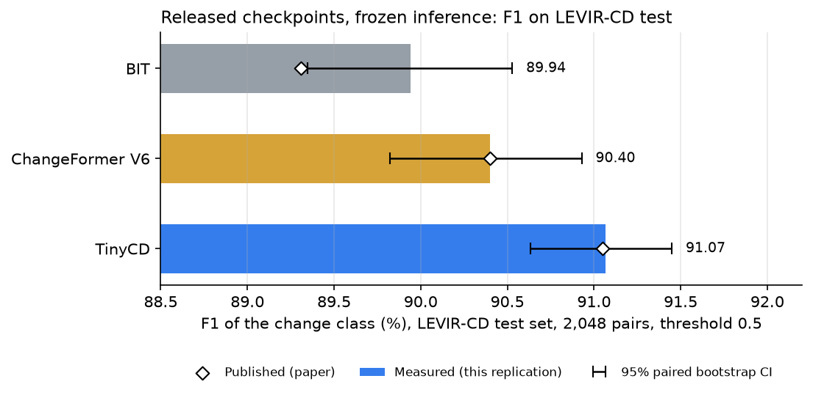
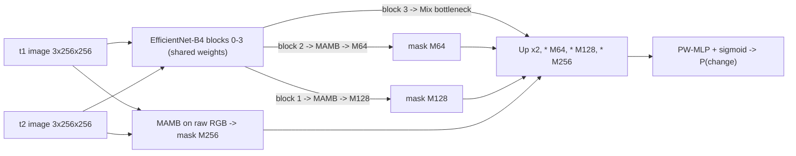
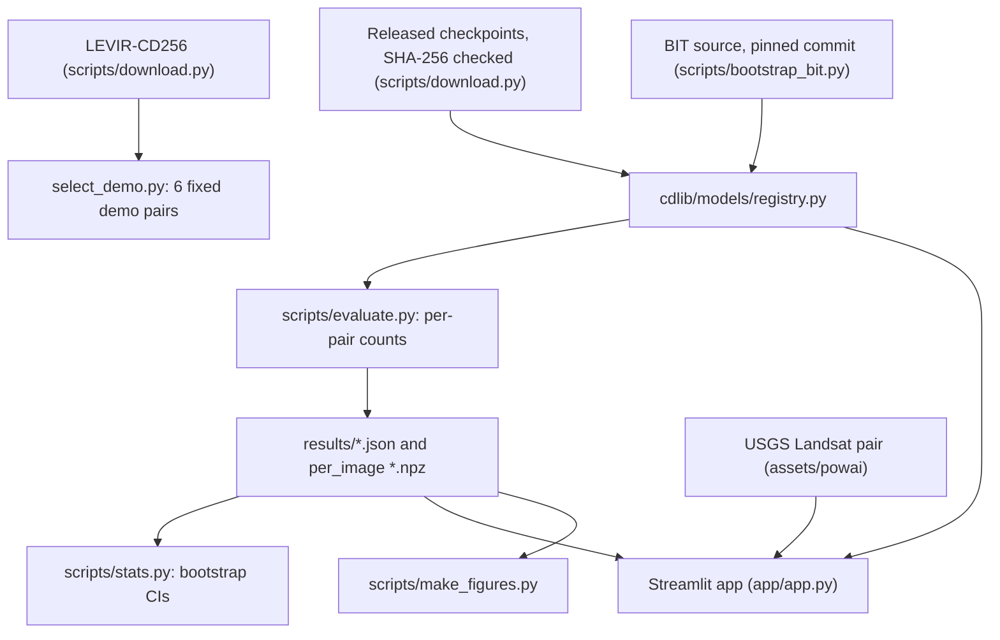
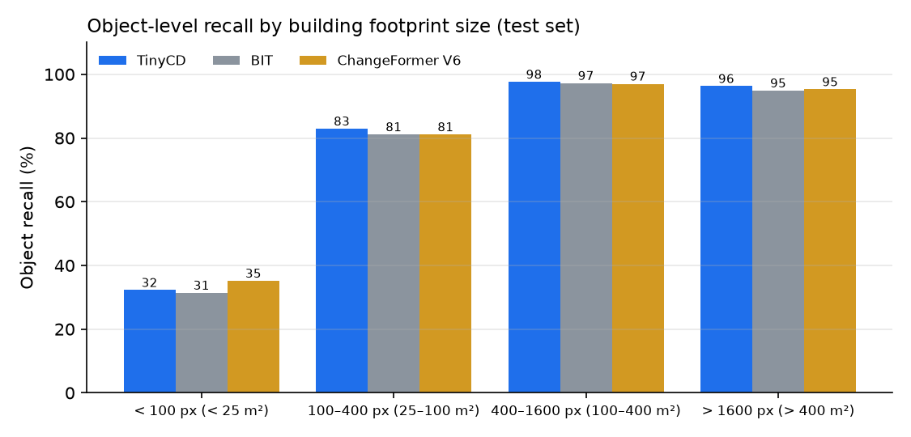
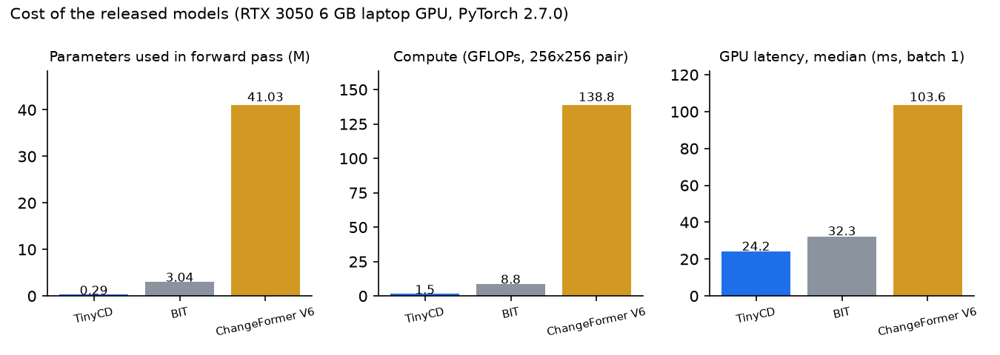
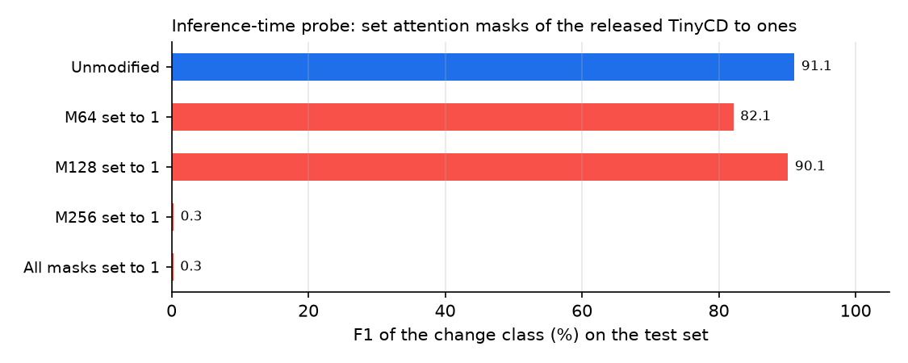
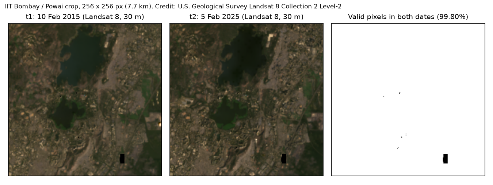

# TinyCD on LEVIR-CD: replicating a lightweight change-detection network


A replication of **TinyCD** (Codegoni, Lombardi & Ferrari, *Neural Computing and Applications*, 2023), a small Siamese U-Net for building-change detection in pairs of satellite or aerial images. Built as a course mini project (IIT Bombay, CE712, Semester 7).



> **Before you run the app:** the Streamlit pages that use LEVIR-CD imagery need the LEVIR-CD256 dataset (2.48 GB) and the demo pairs regenerated from it. `bash setup.sh` does both, but a bare clone with no setup shows empty LEVIR pages. The Powai pages work from the bundled USGS pair.

## Paper

A two-page research-style write-up of this replication is in [`paper/tinycd_replication.pdf`](paper/tinycd_replication.pdf) (LaTeX source: [`paper/tinycd_replication.tex`](paper/tinycd_replication.tex), references: [`paper/references.bib`](paper/references.bib)). It covers the protocol, the benchmark with bootstrap intervals, object recall by size, cost, the mask probe, and the claims that hold and do not hold against BIT and ChangeFormer V6.

## Contents

- [Paper](#paper)
- [The problem](#the-problem)
- [Approach](#approach)
- [Results](#results)
- [Quick start](#quick-start)
- [Tech stack](#tech-stack)
- [Learnings](#learnings)
- [Repository layout](#repository-layout)
- [References and data](#references-and-data)
- [License](#license)

## The problem

Given two co-registered images of the same place taken at times t1 and t2, mark the pixels where a *relevant* change happened, here buildings built or demolished, and ignore irrelevant changes such as lighting, shadows and seasons. It is a per-pixel binary classification task.

Changed pixels are rare. In the LEVIR-CD test set only 5.09% of pixels are change (`results/data_summary.json`), so a model that predicts "no change" everywhere would still score about 95% overall accuracy. This project therefore reports precision, recall, F1 and IoU of the change class only.

## Approach

This is an **inference replication**. The released TinyCD, BIT and ChangeFormer checkpoints are frozen and run under one protocol: threshold 0.5, all 2,048 LEVIR-CD test pairs, no test-time tricks, nothing tuned on the test set (`scripts/evaluate.py`). No model is trained in this repository. An earlier plan included training; it was dropped to keep the replication honest about what was measured.



*MAMB = Mix + attention mask block. The structure follows `cdlib/models/tinycd.py`, which loads the authors' released weights with `strict=True`.*

Pipeline:



## Results

**Benchmark: LEVIR-CD test, 2,048 pairs, threshold 0.5.** Paper values are from Codegoni et al. (2023), Table 1 (LEVIR-CD comparison). Measured values are from `results/eval_*_test.json`. CIs are 95% bootstrap intervals over pairs, 2,000 resamples, seed 0 (`results/stats.json`).

| Model | Paper F1 | Measured F1 | 95% CI | Measured IoU | Precision | Recall |
|---|---:|---:|---|---:|---:|---:|
| TinyCD (this replication) | 91.05 | 91.07 | [90.63, 91.45] | 83.60 | 92.66 | 89.53 |
| BIT (official code) | 89.31 | 89.94 | [89.35, 90.53] | 81.72 | 90.33 | 89.56 |
| ChangeFormer V6 (official code) | 90.40 | 90.40 | [89.82, 90.93] | 82.48 | 92.06 | 88.80 |

**Paired differences** (TinyCD F1 minus comparator F1, same resampled images, `results/stats.json`):

- vs BIT: +1.12 points, 95% CI [0.69, 1.57].
- vs ChangeFormer V6: +0.67 points, 95% CI [0.29, 1.00].

**The paper's margin claim, stated plainly.** The paper says TinyCD beats the comparators by at least 1 point on F1 and IoU. In this replication that holds against BIT (+1.12 F1). Against ChangeFormer V6 the F1 margin is +0.67, which is positive and statistically clear but **below 1 point**. The IoU margin against ChangeFormer is +1.11.

**BIT does not match the paper.** Measured 89.94 vs paper 89.31. The cause is unknown; the paper's exact evaluation setup for BIT is not reproduced here.



Object-level recall (8-connected components of the ground-truth mask, `cdlib/analysis.py`) is 89.2% for TinyCD (7,732 of 8,673 objects), 88.4% for BIT and 88.7% for ChangeFormer. Small buildings are the weak point: under 25 m² (100 px at 0.5 m/px), recall is 32.2% for TinyCD, 31.4% for BIT and 35.2% for ChangeFormer. Recall above 400 m² is 94.9% to 96.3%.

**Cost of the released models** (`results/efficiency.json`, RTX 3050 6 GB laptop GPU, PyTorch 2.7.0 + CUDA 12.6, one 256x256 pair):

| Model | Parameters used | GFLOPs | GPU median latency | CPU median latency (8 threads) |
|---|---:|---:|---:|---:|
| TinyCD | 285,128 | 1.46 | 24.2 ms | 194 ms |
| BIT | 3.04 M (11.9 M loaded) | 8.76 | 32.3 ms | 266 ms |
| ChangeFormer V6 | 41.03 M | 138.8 | 103.6 ms | 2,454 ms |



Latency numbers are specific to that laptop and are not timing promises for other hardware.

**Mask probe (an inference-time intervention, not a retrained ablation).** Setting one of TinyCD's attention masks to ones on the test set (`results/probes.json`):



Setting the full-resolution mask M256 to ones drops F1 from 91.1 to 0.3. The released network depends heavily on that mask. No ablation weights were released, so ablation *accuracy* is not measured here.

**Real imagery, outside the benchmark domain.** The Powai demonstration applies the same checkpoints to two 30 m Landsat 8 scenes of the IIT Bombay campus, 10 February 2015 and 5 February 2025 (USGS). The released models were trained on 0.5 m aerial imagery. The pair has 65,406 of 65,536 valid pixels (99.80%). At threshold 0.5, **all three models predict zero changed pixels**. The maximum probabilities are 0.0077 (TinyCD), 0.0094 (BIT) and 0.0011 (ChangeFormer) (`assets/powai/predictions/report.json`, `VALIDATION.md`). This is exploratory domain transfer with no reference labels. It is not evidence of accuracy, and it is not proof that nothing changed.



**Verification.** Strict loading of all three checkpoints, and the saved per-image arrays reproduce the aggregate metrics (`results/verification.json`, `scripts/verify_artifacts.py`).

## Quick start

Requirements: Linux, WSL, Apple Silicon macOS, or Windows x64 with Git Bash; Internet; about 15 GB free disk.

```bash
git clone <this-repository-url> ce712-tinycd
cd ce712-tinycd
bash setup.sh          # Python 3.12 runtime, CPU PyTorch, pinned packages, BIT source,
                       # released weights, LEVIR-CD256 (2.48 GB), demo pairs, install check
./streamlit run app/app.py
```

Open http://localhost:8501. Stop with Ctrl+C.

Other commands:

```bash
./python -m pytest -q                       # test suite (needs the setup above)
./python scripts/evaluate.py --model tinycd # full test-set evaluation (under a minute per model on the recorded GPU)
./python scripts/make_figures.py            # regenerate figures/ from results/
```

`setup.sh --cuda` installs the CUDA 12.6 build. The `./python` and `./streamlit` launchers select the local `.venv`.

## Tech stack

- Python 3.12, PyTorch 2.7.0 with torchvision 0.22 (EfficientNet-B4 encoder slice)
- timm, einops, fvcore (FLOP counts), NumPy, SciPy, pandas
- Rasterio (GeoTIFF processing for the Landsat pair)
- Streamlit and Altair (interactive app), Matplotlib (figures)
- pytest (tests for metrics, architecture, inference, USGS processing, download integrity)

## Learnings

- **Overall accuracy hides the change class.** With about 5% change pixels, F1 and IoU of the change class are the meaningful numbers.
- **Strict checkpoint loading is a strong architecture test.** Loading the authors' weights with `strict=True` requires every key and tensor shape to match, which checks the re-implementation far more tightly than output comparison alone.
- **Reproduction is not automatic.** TinyCD and ChangeFormer land within rounding of the paper. BIT is 0.6 F1 above its published figure, and the cause is not found.
- **Claims depend on the comparator.** The "+1 point" margin holds against BIT and not against ChangeFormer V6 here.
- **Small buildings remain hard.** Under 25 m², every model recalls only about a third of the objects.
- **Inference-time probes can reveal dependence.** Zeroing the full-resolution mask collapses F1, which says more about what the network uses than a headline score does.
- **Domain transfer needs its own evidence.** Models trained on 0.5 m imagery returned zero detections on 30 m Landsat. That is a limit to report, not a result to hide.
- **Scope can shrink to what the evidence supports.** The project was narrowed from training to inference-only, and the claims were rewritten to match.

## Repository layout

| Path | Contents |
|---|---|
| `app/` | Streamlit app: Home and pages 1 to 12 (problem, architecture, mix, masks, inference, results, efficiency, ablations, failures, Powai, limitations, guide) |
| `cdlib/` | Data loading, TinyCD implementation, model registry, metrics, analysis, USGS preparation, exports |
| `cdlib/models/vendor/changeformer/` | Official ChangeFormer code (MIT, kept with its licence) |
| `scripts/` | Download, BIT bootstrap, evaluation, statistics, probes, shift tests, USGS search and inference, verification, figures |
| `results/` | Full-test metrics, per-image arrays, efficiency, probes, shift tests, verification record |
| `assets/powai/` | USGS Landsat 8 selection metadata, prepared 256x256 RGB pair, saved predictions |
| `notebooks/` | Optional inference walkthroughs |
| `tests/` | Metrics, architecture, inference, USGS, download integrity, app smoke tests |
| `dashboard/dist/` | Static HTML/JS view of the benchmark results |
| `figures/` | Figures in this README (regenerated by `scripts/make_figures.py`) |
| `demo_guide.md`, `USGS_WORKFLOW.md`, `VALIDATION.md`, `THIRD_PARTY.md` | Walkthrough, USGS procedure, validation record, sources and licences |

Not in this repository (fetched or generated by setup): LEVIR-CD256, the three checkpoints, BIT source code, and `assets/demo/`.

## References and data

- Codegoni, A., Lombardi, G., Ferrari, A. (2023). *TinyCD: a (not so) deep learning model for change detection.* Neural Computing and Applications 35, 8471–8486. https://doi.org/10.1007/s00521-022-08122-3
- Chen, H., Shi, Z. (2020). *A spatial-temporal attention-based method and a new dataset for remote sensing image change detection.* Remote Sensing 12(10), 1662. https://doi.org/10.3390/rs12101662. Dataset and terms: https://justchenhao.github.io/LEVIR/ (academic use only; commercial use prohibited).
- Chen, H., Qi, Z., Shi, Z. *Remote Sensing Image Change Detection with Transformers* (BIT). Official code: https://github.com/justchenhao/BIT_CD, commit `adcd7aea6f234586ffffdd4e9959404f96271711`.
- Bandara, W. G. C., Patel, V. M. *A Transformer-Based Siamese Network for Change Detection* (ChangeFormer). Official code: https://github.com/wgcban/ChangeFormer, commit `afd1b7ed640aa265a2c730de958416ae7356a2f9`.
- Tan, M., Le, Q. V. (2019). *EfficientNet: Rethinking model scaling for convolutional neural networks.* ICML.
- U.S. Geological Survey. Landsat 8 Collection 2 Level-2 Surface Reflectance, scenes `LC08_L2SP_148047_20150210_20200909_02_T1` and `LC08_L2SP_148047_20250205_20250208_02_T1`. https://doi.org/10.5066/P9OGBGM6. Credit: USGS.

## License

The original code in this repository is released under the MIT License (see `LICENSE`). The vendored ChangeFormer code keeps its MIT licence. BIT source, LEVIR-CD imagery, the checkpoints and the published papers are not redistributed here and keep their own terms. See `THIRD_PARTY.md`.

Shresth Keshari
